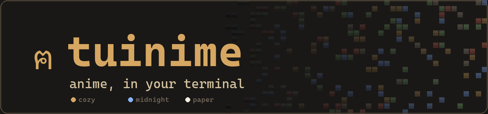
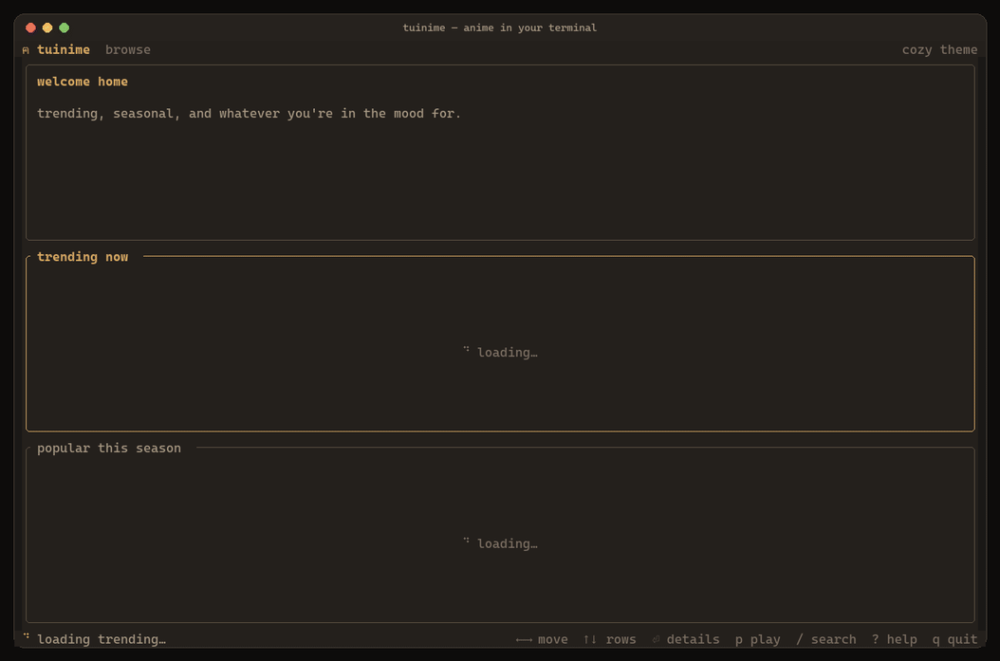
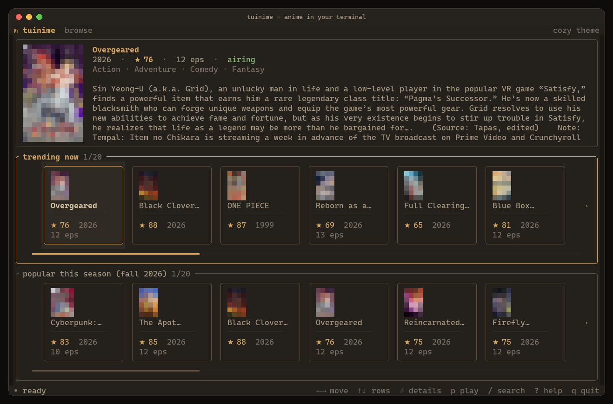
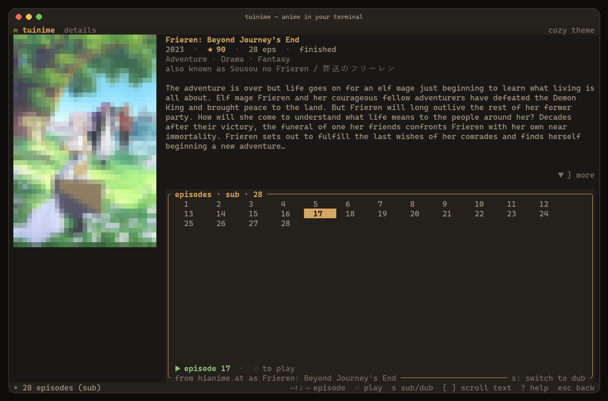
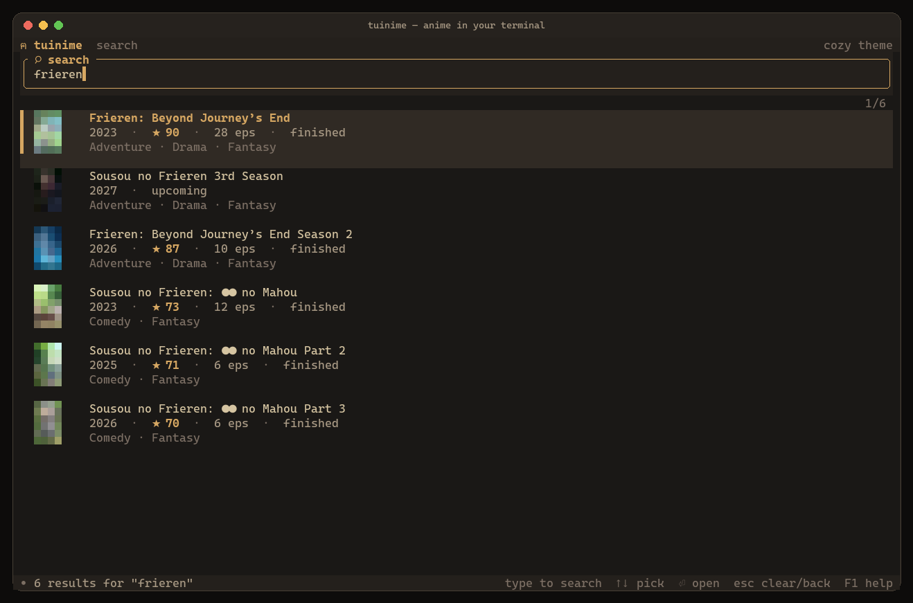
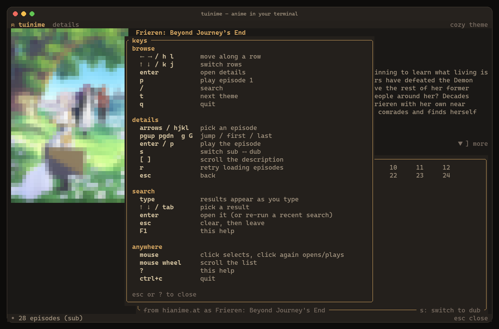
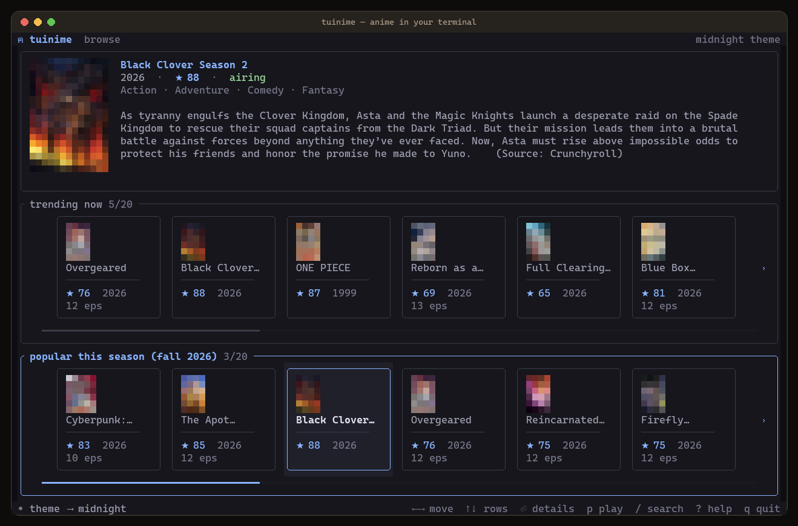
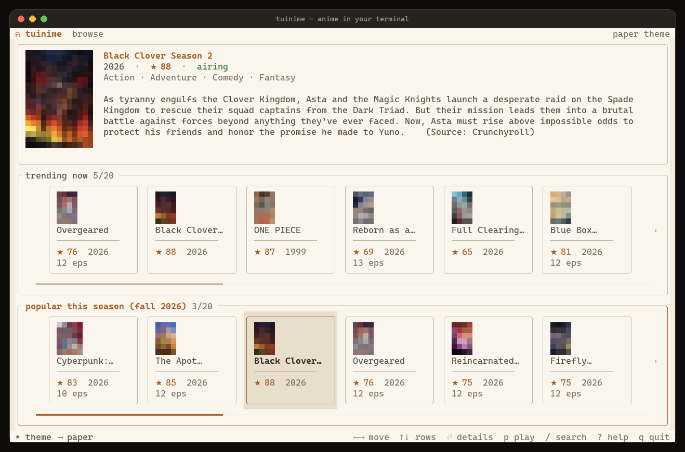
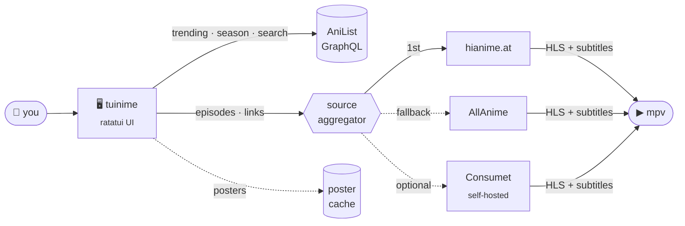

<div align="center">



### ฅ^•ﻌ•^ฅ &nbsp; anime, in your terminal &nbsp; ฅ^•ﻌ•^ฅ

**Browse what's trending, search anything, pick an episode, and press Enter.**<br>
A cozy, poster-first TUI that streams straight into [mpv](https://mpv.io) — no browser, no ads, no tabs.

[](https://www.rust-lang.org)
[](https://ratatui.rs)
[](https://mpv.io)
[](#-quick-start)
[](Cargo.toml)

<br>



<sub>Recorded from the real app with live data — trending, search and the Frieren episode list are what the services returned that day.</sub>

</div>

---

<details>
<summary><b>📖 Contents</b></summary>

- [✨ Features](#-features)
- [📸 A closer look](#-a-closer-look)
- [🚀 Quick start](#-quick-start)
- [⌨️ Keys](#️-keys)
- [🧭 How it works](#-how-it-works)
- [📡 Video sources](#-video-sources)
- [⚙️ Configuration & files](#️-configuration--files)
- [🛠️ Development](#️-development)
- [🩺 Troubleshooting](#-troubleshooting)
- [💛 Credits](#-credits)

</details>

## ✨ Features

<table>
<tr>
<td width="50%" valign="top">

### 🎴 Poster-first browsing
A big hero panel for whatever you're hovering, rows of **Trending Now** and **Popular This Season** underneath, and **Continue Watching** once you've played something. Real cover art in the terminal — sharp on Kitty / Sixel / iTerm2, and still there (as half-blocks) everywhere else.

</td>
<td width="50%" valign="top">

### 🔎 Search as you type
Results appear while you type, with posters, score, year and genres. Recent searches are one keypress away, and a slow old search can never overwrite a newer one.

</td>
</tr>
<tr>
<td valign="top">

### 📺 Real episode picker
A full details page with poster, synopsis, alternate titles and an episode grid you move through with the arrow keys. Toggle **sub ↔ dub** with <kbd>s</kbd>.

</td>
<td valign="top">

### 🛟 Sources that fall back
If one source is blocked or broken, tuinime finds the **same show and episode** on the next one and plays from there — and tells you which one it used.

</td>
</tr>
<tr>
<td valign="top">

### 🎨 Three themes, remembered
**cozy** (warm café), **midnight** (cool blue) and **paper** (light). Your theme, sub/dub choice, recent searches and continue-watching survive restarts.

</td>
<td valign="top">

### 🖱️ Keyboard *and* mouse
Vim keys, arrow keys, <kbd>?</kbd> for help anywhere. Click to select, click again to open or play; the wheel scrolls whatever list you're in.

</td>
</tr>
<tr>
<td valign="top">

### ⚡ Never freezes
Every network call runs in the background with timeouts; spinners show what's loading and errors show up in red at the bottom instead of crashing.

</td>
<td valign="top">

### 📐 Fits any window
The layout resizes with your terminal: posters keep their shape, cards stretch to fill rows, and key hints step aside on narrow windows.

</td>
</tr>
</table>

## 📸 A closer look

<table>
<tr>
<td width="50%"><p align="center"><b>Browse</b> — hero panel + rows</p></td>
<td width="50%"><p align="center"><b>Details</b> — synopsis + episode grid</p></td>
</tr>
<tr>
<td><p align="center"><b>Search</b> — results as you type</p></td>
<td><p align="center"><b>Help</b> — press <kbd>?</kbd> anywhere</p></td>
</tr>
</table>

<details>
<summary><b>🎨 The three themes</b> — press <kbd>t</kbd> to cycle</summary>
<br>

| cozy | midnight | paper |
|:---:|:---:|:---:|
|  |  |  |

</details>

## 🚀 Quick start

### Install

| Platform | Command |
|---|---|
| **Windows** (winget) | `winget install CyberSarvesh.TuiNime` |
| **Windows** (Scoop) | `scoop bucket add tuinime https://github.com/CyberSarvesh/scoop-bucket` then `scoop install tuinime` |
| **macOS / Linux** (Homebrew) | `brew install CyberSarvesh/tap/tuinime` |
| **Arch Linux** (AUR) | `yay -S tuinime-bin` |
| **Any OS** (Rust) | `cargo install tuinime` or `cargo binstall tuinime` |

Or use the one-line installers from the [latest release](https://github.com/CyberSarvesh/TuiNime/releases/latest):

```bash
# macOS / Linux
curl --proto '=https' --tlsv1.2 -LsSf https://github.com/CyberSarvesh/TuiNime/releases/latest/download/tuinime-installer.sh | sh
```

```powershell
# Windows PowerShell
powershell -ExecutionPolicy Bypass -c "irm https://github.com/CyberSarvesh/TuiNime/releases/latest/download/tuinime-installer.ps1 | iex"
```

### mpv

tuinime plays video in [mpv](https://mpv.io/installation/), so it needs to be on your `PATH`. Scoop and the AUR install it for you; otherwise:

```bash
winget install shinchiro.mpv   # Windows
brew install mpv               # macOS
sudo apt install mpv           # Debian / Ubuntu
```

### From source

With a recent stable [Rust](https://rustup.rs) toolchain, from this folder:

```bash
cargo run --release      # try it
cargo install --path .   # or install the tuinime command
```

> [!TIP]
> For crisp posters use a terminal with an image protocol — Kitty graphics, Sixel or iTerm2 (e.g. **Kitty**, **WezTerm**, **iTerm2**, **foot**). tuinime asks the terminal what it supports at startup and falls back to half-block art otherwise.

## ⌨️ Keys

<table>
<tr><th>Browse</th><th>Details</th><th>Search</th></tr>
<tr valign="top">
<td>

| key | does |
|---|---|
| <kbd>←</kbd><kbd>→</kbd> / <kbd>h</kbd><kbd>l</kbd> | move along a row |
| <kbd>↑</kbd><kbd>↓</kbd> / <kbd>k</kbd><kbd>j</kbd> | switch rows |
| <kbd>Enter</kbd> | open details |
| <kbd>p</kbd> | play episode 1 |
| <kbd>/</kbd> | search |
| <kbd>t</kbd> | next theme |
| <kbd>q</kbd> | quit |

</td>
<td>

| key | does |
|---|---|
| arrows / <kbd>hjkl</kbd> | pick an episode |
| <kbd>PgUp</kbd><kbd>PgDn</kbd> | jump |
| <kbd>g</kbd> / <kbd>G</kbd> | first / last |
| <kbd>Enter</kbd> / <kbd>p</kbd> | play it |
| <kbd>s</kbd> | sub ↔ dub |
| <kbd>[</kbd> <kbd>]</kbd> | scroll synopsis |
| <kbd>r</kbd> | retry episodes |
| <kbd>Esc</kbd> | back |

</td>
<td>

| key | does |
|---|---|
| *type* | live results |
| <kbd>↑</kbd><kbd>↓</kbd> / <kbd>Tab</kbd> | pick a result |
| <kbd>Enter</kbd> | open it |
| <kbd>Esc</kbd> | clear, then leave |
| <kbd>Ctrl</kbd>+<kbd>U</kbd> | clear |
| <kbd>F1</kbd> | help |

</td>
</tr>
</table>

**Anywhere:** <kbd>?</kbd> help · <kbd>Ctrl</kbd>+<kbd>C</kbd> quit · mouse click selects, click again opens/plays · wheel scrolls. While mpv plays, <kbd>Esc</kbd> stops it.

## 🧭 How it works



1. **Metadata** — titles, posters, scores and synopses come from [AniList](https://anilist.co)'s public GraphQL API.
2. **Matching** — stream sites don't know AniList IDs, so tuinime searches each source by the English title *and* the romaji/native titles, then picks the closest match (exact → prefix → substring), skipping empty listings.
3. **Episodes** — the first source that lists the show supplies the episode grid.
4. **Playback** — the chosen episode's links come from that source; if it fails, the same episode number is looked up on the next source. The best quality goes to mpv with the Referer and subtitle tracks it needs.
5. **Everything is async** — each request is a background task that reports back to the UI loop, so drawing never waits on the network.

## 📡 Video sources

| source | status | notes |
|---|---|---|
| **hianime.at** | ✅ works | Same flow as current [ani-cli](https://github.com/pystardust/ani-cli). 360p–1080p HLS, sub & dub, English subtitles. Tried first. |
| **AllAnime** | ⚠️ search only | Lists shows and episodes, but currently refuses video links to apps (`NEED_CAPTCHA`). Kept as a fallback in case that changes. |
| **Consumet** | 💤 off by default | Only used if you run your own [Consumet](https://github.com/consumet/api.consumet.org) instance and set `MIRU_CONSUMET_URL`. |

Sources are plain Rust modules under [`src/backend/providers/`](src/backend/providers) implementing one small trait — `search`, `episodes`, `streams` — so adding another is one file.

> [!NOTE]
> These are third-party sites that change without notice. tuinime uses ordinary HTTP requests only — no CAPTCHA solving, no bot-detection workarounds — so if a site starts blocking apps, that source simply reports it and the next one is tried.

## ⚙️ Configuration & files

| what | where |
|---|---|
| Settings & history (theme, sub/dub, recent searches, continue watching) | `<config dir>/tuinime/state.json` — e.g. `%APPDATA%\tuinime\state.json` on Windows |
| Log file (nothing is ever printed over the UI) | `<cache dir>/tuinime/tuinime.log` |
| Poster cache | `<cache dir>/tuinime/posters/` |

| environment variable | effect |
|---|---|
| `RUST_LOG=debug` | more detail in the log file (default `warn`) |
| `MIRU_CONSUMET_URL=http://localhost:3000` | enable the Consumet source against your own instance |

## 🛠️ Development

```bash
cargo test                    # 50 offline tests: screens, keys, mouse, parsing, fallback
cargo test -- --ignored       # live checks against AniList, hianime.at and AllAnime
cargo clippy --all-targets    # kept at zero warnings
```

The screen tests render the whole app into an off-screen buffer, so layouts are checked at many window sizes without a terminal. Set `TUINIME_SNAPSHOTS=1` and add `-- --nocapture` to print them.

<details>
<summary><b>🎬 Re-recording the demo GIF</b></summary>
<br>

The GIF and screenshots above are generated from the real app, not mocked up:

```bash
cargo test record_demo -- --ignored    # scripted tour with live data → target/demo/frames.json
python docs/tools/render_demo.py       # frames → docs/media/demo.gif + screenshots
```

The renderer needs Pillow and ffmpeg, and uses the Cascadia Mono / Segoe UI Symbol / Yu Gothic fonts that ship with Windows.

</details>

<details>
<summary><b>🗂️ Project layout</b></summary>
<br>

```text
src/
├── main.rs                  terminal setup, event loop, log file
├── backend/                 everything that talks to the network
│   ├── cache.rs             poster download + disk cache
│   ├── player.rs            mpv process (Referer, subtitles, IPC)
│   └── providers/
│       ├── anilist.rs       metadata: trending, seasonal, search
│       ├── aggregator.rs    title matching + cross-source fallback
│       ├── hianime.rs       hianime.at source
│       ├── allanime.rs      AllAnime source
│       └── scraper.rs       Consumet source (self-hosted)
└── frontend/                everything you see
    ├── app.rs               state machine + key/mouse handling
    ├── services.rs          background tasks → BgEvent
    ├── persist.rs           state.json
    ├── theme.rs             cozy · midnight · paper
    ├── screens/             browse · details · search · help · player
    ├── ui/                  header/footer, hero, carousels, demo recorder
    └── widgets/             posters, scrollbar, metadata lines
```

</details>

## 🩺 Troubleshooting

<details>
<summary><b>“failed to spawn mpv”</b></summary>

mpv isn't on your `PATH`. Install it (see [Quick start](#-quick-start)) and check that `mpv --version` works in the same terminal.
</details>

<details>
<summary><b>“no source could play …”</b></summary>

Every enabled source failed for that episode; the message lists each source and why. Usually a site is down or blocking apps for a while — try again later, or try the other language with <kbd>s</kbd>. Run `cargo test -- --ignored` to see which sources currently work.
</details>

<details>
<summary><b>Posters look blocky</b></summary>

Your terminal didn't report an image protocol at startup, so tuinime draws posters with half-block characters. Terminals with Kitty graphics, Sixel or iTerm2 images (Kitty, WezTerm, iTerm2, foot…) show full-resolution art.
</details>

<details>
<summary><b>Trending takes a while to appear</b></summary>

AniList occasionally answers slowly; the rows show a spinner meanwhile and fill in on their own. Requests time out after 20 seconds, after which a small offline list is shown.
</details>

## 💛 Credits

- [**ani-cli**](https://github.com/pystardust/ani-cli) — the source flows here follow its scraping logic
- [**AniList**](https://anilist.co) — metadata and cover art
- [**ratatui**](https://ratatui.rs) & [**ratatui-image**](https://github.com/benjajaja/ratatui-image) — the TUI and terminal graphics
- [**mpv**](https://mpv.io) — the player that does the real work

> [!IMPORTANT]
> tuinime doesn't host or upload any video; it only reads what public sites already serve. Respect copyright and the laws where you live, and support official releases when you can.

<div align="center">
<br>
<sub>made with ♡ and too much tea · MIT licensed</sub>
<br><br>
</div>
